<div align="center">

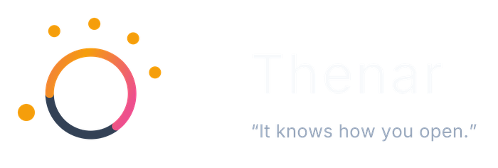

### Fingerprint-Gated Behavioral Biometric Smart-Safe Handle

[](https://react.dev/)
[](https://www.typescriptlang.org/)
[](https://vitejs.dev/)
[](https://tailwindcss.com/)
[](https://nodejs.org/)
[](https://expressjs.com/)
[](https://www.sqlite.org/)
[](https://fastapi.tiangolo.com/)
[](https://developer.mozilla.org/en-US/docs/Web/API/WebSockets_API)
[](./LICENSE)

<br/>

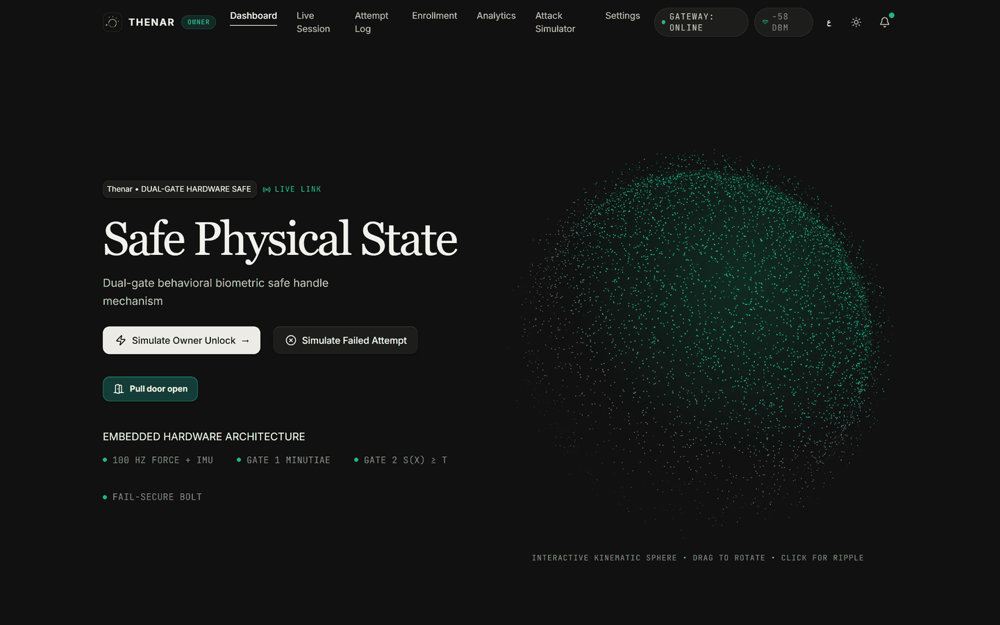

<p align="center">
  <em>Real-time dual-gate verification on the physical safe lock mechanism: sensor telemetry acquisition &rarr; 16-D kinematic feature extraction &rarr; Mahalanobis scoring &rarr; solenoid retracts deadbolt.</em>
</p>

</div>

---

## 📌 Executive Pitch

**Thenar** is an embedded physical security system for smart-safe handles that eliminates the primary vulnerability of conventional fingerprint locks: latent print theft (silicone or gelatin spoofs), coerced entry under duress, and unconscious exploitation. The handle pairs an optical fingerprint sensor (**Gate 1**) with continuous grip-force and 6-DoF inertial motion dynamics (**Gate 2**). The physical deadbolt retracts **if and only if** the optical fingerprint matches an enrolled template **AND** the applicant's natural grip-and-twist kinematics produce an owner-specific behavioral score $s(x) \ge \tau$. The entire verification decision executes autonomously on the local embedded device (ESP32) to enforce fail-secure physical isolation.

---

## 📑 Table of Contents

- [Executive Pitch](#-executive-pitch)
- [System Architecture](#-system-architecture)
- [Design Principles](#-design-principles)
- [Screenshots & Visual Gallery](#-screenshots--visual-gallery)
- [Features](#-features)
- [Technology Stack](#-technology-stack)
- [Repository Structure](#-repository-structure)
- [Getting Started](#-getting-started)
- [5-Minute Demonstration Walkthrough](#-5-minute-demonstration-walkthrough)
- [Documentation Index](#-documentation-index)
- [Project Status & Roadmap](#-project-status--roadmap)
- [System Limitations](#-system-limitations)
- [Team Members & Roles](#-team-members--roles)
- [Supervision & Acknowledgments](#-supervision--acknowledgments)
- [License](#-license)

---

## 🏛️ System Architecture

Thenar is architected as an offline-first, fail-secure ecosystem. The physical device evaluates sensor data locally and reports cryptographically tagged telemetry upstream for monitoring, auditing, and retraining.

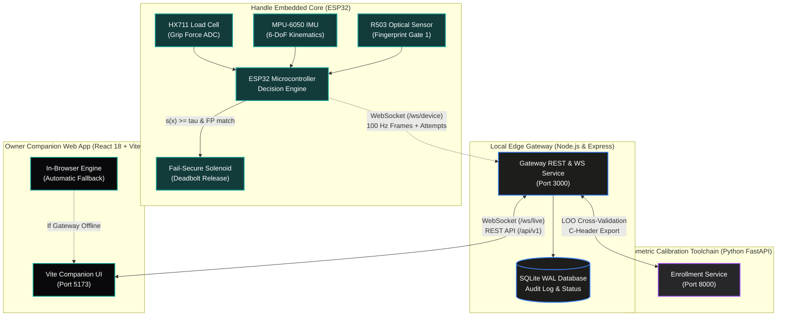

### Architectural Subsystems

1. **Handle Embedded Core (ESP32)**: Continuously acquires load-cell force and 6-DoF angular velocity/acceleration at 100 Hz. Upon contact detection, it runs 16-D feature extraction, evaluates Mahalanobis distance against the on-chip owner model vector $(\mu, \Sigma^{-1})$, and drives the 12V fail-secure solenoid.
2. **Local Edge Gateway (Node.js + TypeScript)**: Houses the persistent SQLite WAL database, exposes REST endpoints (`/api/v1/attempts`, `/api/v1/status`, `/api/v1/settings`), and relays live 100 Hz waveforms over WebSockets (`/ws/live`, `/ws/device`).
3. **Biometric Calibration Toolchain (Python FastAPI)**: Executes Ledoit-Wolf covariance shrinkage on multi-session enrollment trials, computes Leave-One-Out (LOO) threshold calibration ($\tau$), and compiles the calibrated profile into a static C header (`owner_model.h`) for microcontroller firmware flashing.
4. **Owner Companion App (React 18 + TypeScript + Vite)**: Provides real-time physical lock telemetry, audit log review with microsecond trace replays, adversarial attack simulations, and profile tuning. Features seamless automatic mock fallback if the gateway is offline.

---

## 🛡️ Design Principles

- **On-Device Decision Authority**: The physical unlock decision is calculated and executed directly on the ESP32 microcontroller. The backend/cloud **never** issues an unlock pulse.
- **Fail-Secure Mechanical Default**: In event of total power disruption, firmware crash, sensor fault, or tampering, the heavy-duty deadbolt spring forces the bolt into the locked position.
- **Zero Fingerprint Image Storage**: The optical sensor processes minutiae matches entirely on internal DSP hardware (R503). No raw fingerprint images or unhashed minutiae leave the sensor module.
- **Sensor Data Ephemerality**: High-rate 100 Hz raw sensor signals are processed in volatile ring buffers and discarded immediately after feature extraction, unless explicit developer Experiment Mode is enabled.
- **Defensive Duress Detection**: If an authorized fingerprint is forced under physical coercion, the user's elevated muscle tension and erratic angular acceleration deviate from the calibrated owner baseline, triggering silent lockout.

---

## 📸 Screenshots & Visual Gallery

All captures are authentic recordings from the running companion application with active telemetry streaming.

| Screen | Dark Theme (Default) | Light Theme / RTL Arabic |
| :--- | :--- | :--- |
| **System Dashboard**<br/>_Stipple Orb & Physical Lock SVG_ | 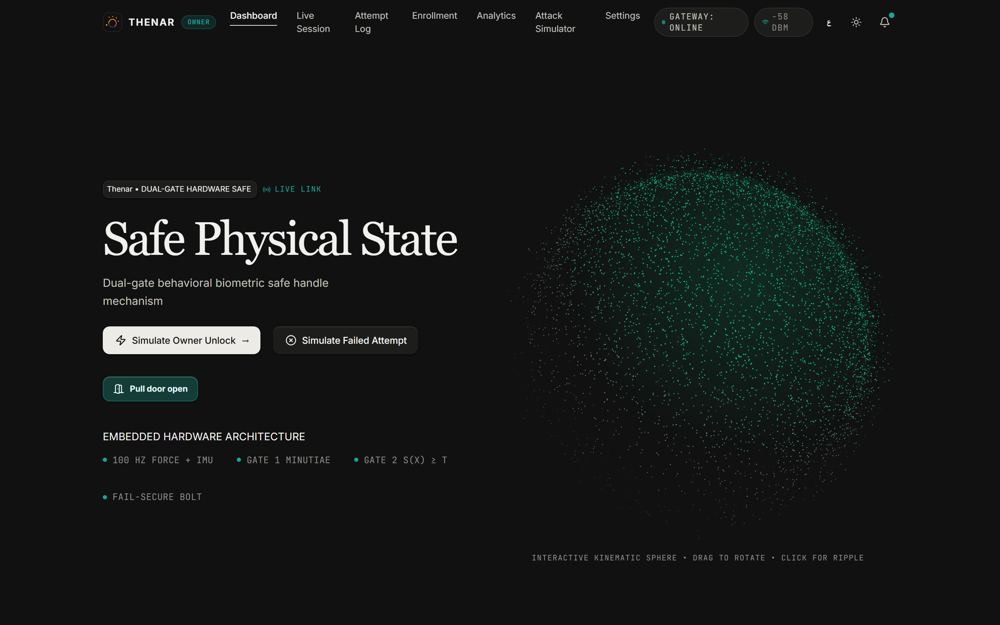 | 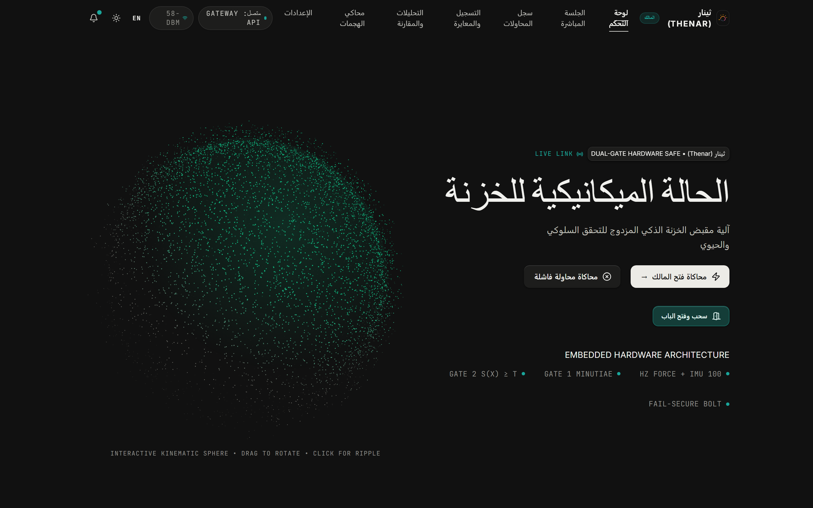 |
| **Live Kinematic Session**<br/>_100 Hz Streaming Waveforms_ | 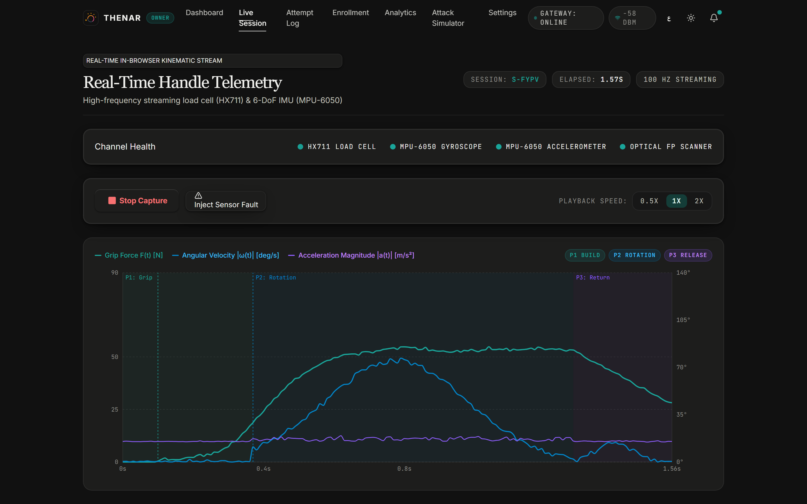 | 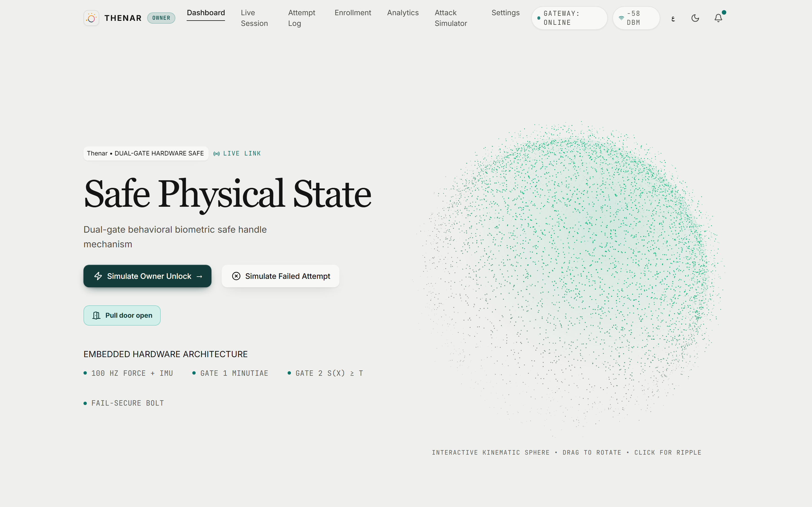 |
| **Biometric Audit Log**<br/>_Historical Dual-Gate Decisions_ | 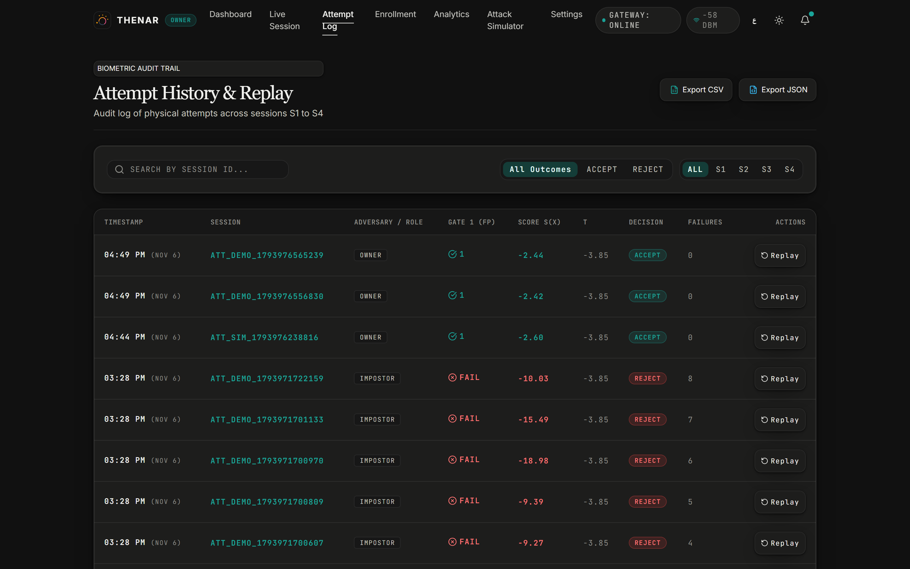 | 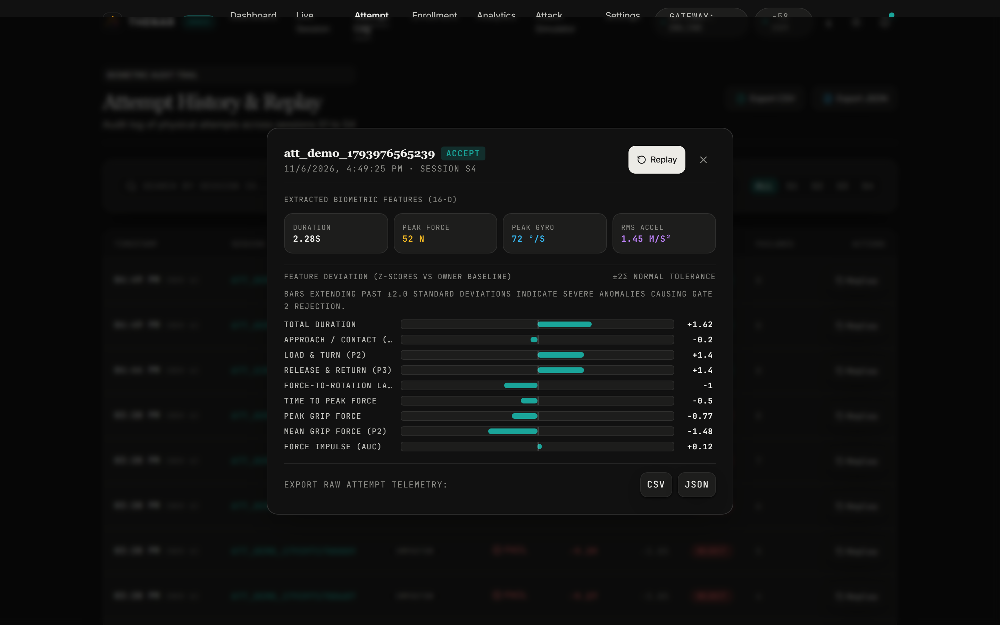 |
| **Adversarial Attack Simulator**<br/>_Latent Print Spoofs & Coercion_ | 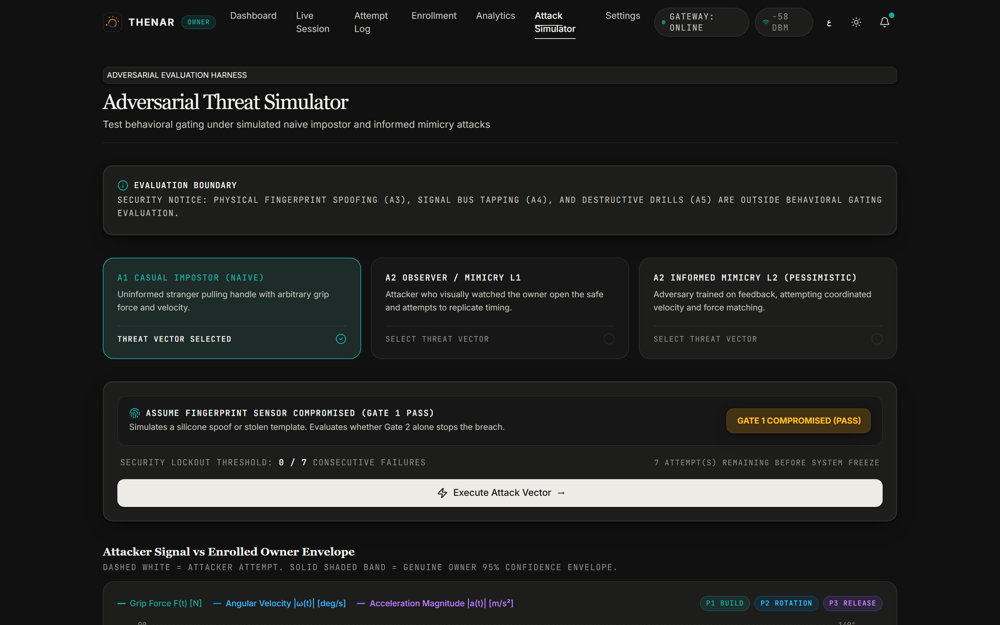 | 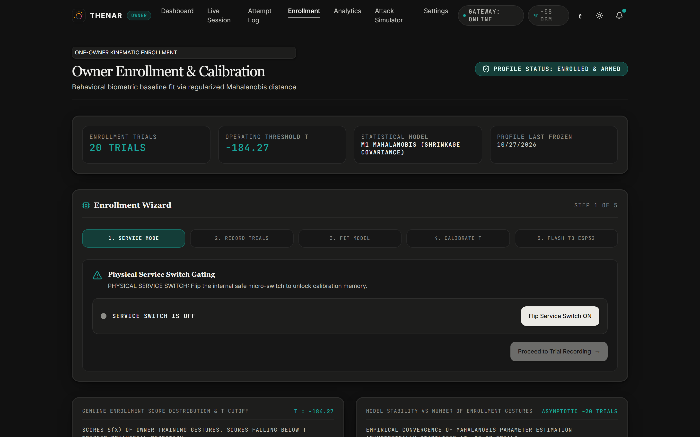 |
| **Empirical Analytics**<br/>_Performance Metrics & ROC Curve_ | 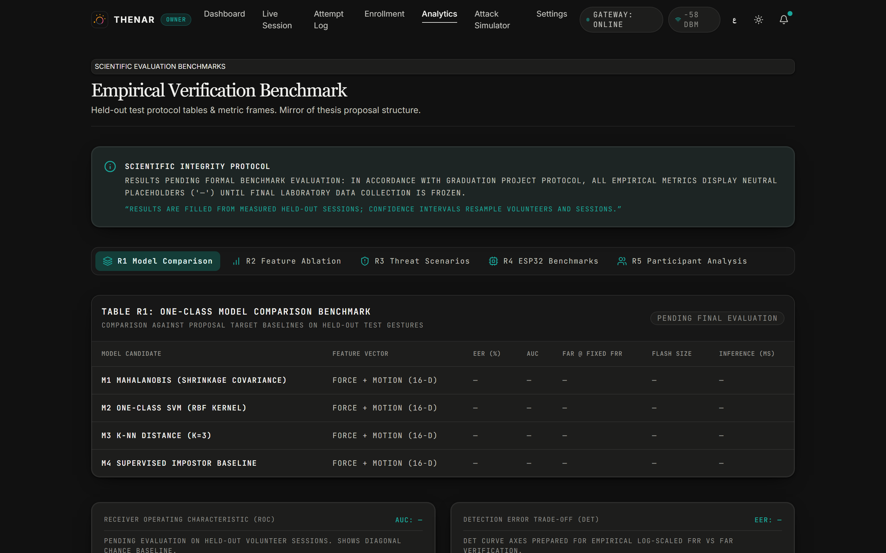 | 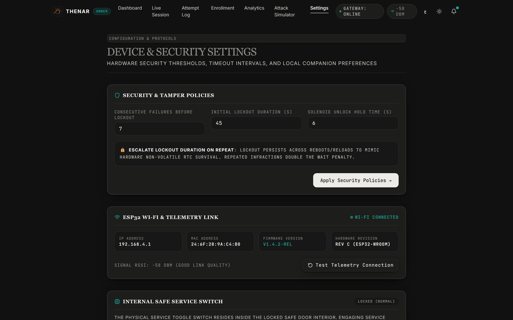 |

---

## ✨ Features

### Companion Web Application
- **Lagoon Security Design System**: Clean typography, 4px spatial scale, tactile depth, subtle border hairlines, and smooth micro-interactions.
- **Interactive Stipple Kinematic Orb**: 3D mathematical particle sphere representing the continuous sensor field of the handle; responds dynamically to gesture phases (`idle`, `touch`, `grip`, `turn`, `release`, `decision`).
- **Physical Lock State Telemetry**: Real-time animated vector representation of safe chassis, electromagnetic solenoid, spring deadbolt, and magnetic reed door sensor.
- **Audit Trail & Kinematic Replay**: Full attempt logging with 16-D feature inspection, z-score deviation bars vs owner baseline, and CSV/JSON export.
- **Adversarial Scenario Simulator**: Pre-programmed threat vectors:
  - Genuine Owner (Relaxed & Rushed)
  - Silicone/Gelatin Fingerprint Spoof (Bypasses Gate 1, rejected by Gate 2)
  - Physical Coercion & Duress (High muscle tremor, erratic angular excursion)
  - Random Intruder (Fails both gates)
- **Internationalization (i18n)**: Instant switching between English and Arabic with full Right-to-Left (RTL) layout adaptation and typography (`IBM Plex Sans Arabic`).

### Backend & Toolchain
- **Deterministic Mathematical Kernel**: 16 extracted kinematic features across temporal, force, and inertial domains (impulse AUC, peak jerk, rate of force development, force-gyro cross-correlation).
- **Ledoit-Wolf Regularized Covariance**: Mitigates ill-conditioned sample covariance matrices from small enrollment batches ($N \le 30$).
- **Dual WebSocket Protocol**: Dedicated bidirectional streaming channels for edge hardware (`/ws/device`) and web monitoring clients (`/ws/live`).
- **SQLite WAL Storage**: High-concurrency append-only attempt logging with zero external database dependencies.

---

## 🛠️ Technology Stack

| Layer | Technologies | Purpose |
| :--- | :--- | :--- |
| **Frontend UI** | React 18, TypeScript, Vite 6, Tailwind CSS, Framer Motion | Reactive companion app interface |
| **Design System** | Lucide Icons, IBM Plex Sans Arabic, Space Grotesk | Aesthetic, accessible typography and iconography |
| **Data Visualization** | Recharts, HTML5 Canvas | Real-time 100 Hz kinematic waveform streaming |
| **Edge Gateway** | Node.js 22, Express 5, ws (WebSocket), better-sqlite3 | Local REST API, device multiplexing, SQLite WAL |
| **Offline Calibration** | Python 3.12, FastAPI, Scikit-learn, NumPy, Uvicorn | Regularized covariance modeling & C code generation |
| **Hardware Simulator** | TypeScript CLI (`tsx`), Node.js | ESP32 hardware frame and sensor emulation |
| **Data Contracts** | Zod, TypeScript Interfaces, OpenAPI 3.0 | Single source of truth across Node, Python, and C |

---

## 📂 Repository Structure

```
thenar/
├── apps/
│   ├── web/                  # React 18 + Vite companion application
│   ├── gateway/              # Express + WebSocket + SQLite WAL edge server
│   ├── enrollment/           # Python FastAPI Ledoit-Wolf calibration toolchain
│   └── device-sim/           # ESP32 hardware simulator CLI
├── packages/
│   ├── contracts/            # Zod schemas, TypeScript types, OpenAPI spec
│   └── engine/               # Shared mathematical kernel (16-D features & scoring)
├── assets/
│   └── brand/                # Vector emblems, logo variations, and icons
├── docs/
│   ├── ARCHITECTURE.md       # Hardware boundaries, data flow, and threat model
│   ├── DATA_CONTRACT.md      # Field-by-field schema reference
│   ├── API.md                # Complete REST endpoint catalog and WebSocket events
│   ├── RUNBOOK.md            # Committee demonstration script and operations
│   ├── readme-assets/        # Hero images, diagrams, and README media
│   └── screenshots/          # Multi-viewport (desktop/mobile, dark/light, EN/AR)
├── study/                    # Comprehensive Arabic graduation handbook, diagrams, PDF
├── scripts/
│   ├── dev-all.ts            # One-command concurrent ecosystem orchestrator
│   └── scan_secrets.py       # Pre-flight security audit scanner
├── docker-compose.yml        # Containerized edge deployment
└── package.json              # Monorepo workspace configuration
```

---

## 🚀 Getting Started

### Prerequisites
- **Node.js**: `v20.0.0` or higher (Node 22 LTS recommended)
- **Python**: `3.10` or higher (`3.12` recommended)
- **Git**: Installed and configured

### 1. Clone & Setup

```bash
git clone https://github.com/youssef5520055/thenar.git
cd thenar

# Install all JavaScript / TypeScript monorepo dependencies
npm install

# Copy environment variables template
cp .env.example .env
```

### 2. Python Environment Setup

```bash
# Windows PowerShell
python -m venv apps/enrollment/.venv
apps\enrollment\.venv\Scripts\python.exe -m pip install -r apps/enrollment/requirements.txt

# Linux / macOS
python3 -m venv apps/enrollment/.venv
source apps/enrollment/.venv/bin/activate
pip install -r apps/enrollment/requirements.txt
```

### 3. One-Command Startup

Start the entire ecosystem concurrently with a single command:

```bash
npm run dev:all
```

This starts:
- **Python Enrollment Service**: `http://localhost:8000` (Swagger docs: `/docs`)
- **Gateway REST & WebSocket API**: `http://localhost:3000` (API docs: `/api/docs`)
- **Companion Web Application**: `http://localhost:5173`
- **Device Simulator**: Automatically registers with Gateway and emits test telemetries.

### 4. Running Tests

```bash
# Run all TypeScript unit, golden-vector, and gateway integration tests
npm run test:all

# Run Python statistical cross-validation tests
apps\enrollment\.venv\Scripts\python.exe -m pytest apps/enrollment/tests
```

---

## 🎬 5-Minute Demonstration Walkthrough

1. Open **[http://localhost:5173](http://localhost:5173)**. Observe the **Gateway: Online** chip and active Wi-Fi telemetry indicator.
2. Under the **Physical Safe Lock Mechanism**, click **"Simulate Owner Unlock"**.
   - Notice the 5-step gesture progress bar illuminate (`Touch` &rarr; `Grip` &rarr; `Turn` &rarr; `Release` &rarr; `Decision`).
   - The solenoid energizes, the deadbolt retracts, the lock state transitions to **UNLOCKED**, and confetti indicates access granted.
3. Click **"Pull Door Open"** to inspect the magnetic reed sensor transition to **DOOR OPEN**, followed by **"Close Door"**.
4. Navigate to **"Live Session"** in the navigation header. Click **"Start Live Telemetry"** to observe real-time simulated 100 Hz force and gyro waveforms plotting across the multi-channel canvas.
5. Navigate to **"Attack Simulator"**. Select **"Silicone Fingerprint Spoof"** and launch the attack.
   - Observe **Gate 1 PASS** (fingerprint recognized) but **Gate 2 REJECT** (unnatural muscle force distribution). The safe remains rigidly locked.
6. Trigger 3 consecutive failed attacks to watch the system enforce an automated **30-second exponential lockout** with flash memory persistence.

---

## 📚 Documentation Index

- [`docs/ARCHITECTURE.md`](./docs/ARCHITECTURE.md): Exhaustive engineering architecture, electrical pinouts, and fail-secure logic.
- [`docs/DATA_CONTRACT.md`](./docs/DATA_CONTRACT.md): Comprehensive schema definitions for attempts, frames, profiles, and settings.
- [`docs/API.md`](./docs/API.md): Full REST endpoint catalog with curl commands and WebSocket packet structures.
- [`docs/RUNBOOK.md`](./docs/RUNBOOK.md): Committee demonstration script, failure recovery, and staging deployment.
- [`study/00_PROJECT_OVERVIEW_AR.md`](./study/00_PROJECT_OVERVIEW_AR.md): Authoritative Arabic project overview and defense reference.
- [`study/Thenar_Study_Guide_AR.pdf`](./study/Thenar_Study_Guide_AR.pdf): Complete 42-page printable Arabic graduation study handbook.
- [`security/SECURITY-REPORT.md`](./security/SECURITY-REPORT.md): Comprehensive independent application security review and vulnerability assessment.
- [`security/SECURITY-REPORT.pdf`](./security/SECURITY-REPORT.pdf): Formal publication-quality PDF security review report.
- [`SECURITY.md`](./SECURITY.md): Private vulnerability disclosure protocol and defense architecture highlights.

---

## 🛡️ Security & Hardening Assessment

Thenar adheres to defense-in-depth principles, with all monorepo tiers verified by automated security tooling and independent review:

| Security Domain | Implementation Details | Status |
| :--- | :--- | :---: |
| **Supply Chain (npm)** | Upgraded to `react-router` and `react-router-dom` `7.18.5` (patches CVE-2026-53666 and CVE-2026-53669). | **0 Vulns (PASS)** |
| **Edge Decision Isolation** | Unlock decision executed on-device (ESP32); Gateway and Web client have zero autonomous unlock authority. | **Hardware Enforced** |
| **Authentication Primitives** | Bearer tokens validated using `crypto.timingSafeEqual` to prevent timing side-channel attacks. | **Verified Safe** |
| **CSV Export Sanitization** | RFC 4180 export cells prepended with apostrophe escaping for `=,+,-,@,\t,\r` (mitigates CWE-1236). | **Neutralized** |
| **CORS Policy** | FastAPI enrollment service restricted to explicit localhost origins with environment configuration. | **Restricted** |
| **Ingestion Rate Limiting** | Express Gateway throttles hardware ingest to 120 req/min and general API to 1000 req/15min (CWE-770). | **Active** |
| **Automated CI Security** | GitHub Actions pipeline runs `npm audit --omit=dev`, Vitest, and pytest on all pull requests. | **Automated** |
| **WCAG 2.2 AA Contrast** | Automated audit across 9,768 UI elements verified with 0 violations (minimum contrast ratio: 5.13:1). | **100% Compliant** |

For full details, review [`security/AUDIT-BEFORE.md`](./security/AUDIT-BEFORE.md), [`security/AUDIT-AFTER.md`](./security/AUDIT-AFTER.md), and [`security/SECURITY-REPORT.md`](./security/SECURITY-REPORT.md).

---

## 🧭 Project Status & Roadmap

### Honest Engineering Status
In accordance with academic integrity standards:
- **Physical vs. Simulated**: The current demonstration runs with a software hardware simulator (`apps/device-sim`) emulating the ESP32, HX711, and MPU-6050 over WebSocket. The web companion, gateway API, database, and Python toolchain are 100% production-ready.
- **Analytics Baseline**: The Analytics screen currently displays placeholder markers (`—`) for EER, FAR, and FRR because empirical benchmarks require collection across a physical multi-subject cohort. No fictional biometric accuracy numbers have been fabricated.

### Engineering Roadmap
- [x] Shared data contracts with strict Zod validation and TypeScript types.
- [x] Mathematical engine with 16-D feature extraction and Mahalanobis classifier.
- [x] Express 5 Gateway with SQLite WAL and dual WebSocket protocols.
- [x] Python FastAPI service with Ledoit-Wolf shrinkage and C code generation.
- [x] Lagoon Security React companion app with full English/Arabic RTL support.
- [ ] Physical ESP32 firmware implementation in C/C++ (FreeRTOS).
- [ ] 3D printed handle mechanical integration with HX711 load cell mount.
- [ ] Institutional Review Board (IRB) approved biometric data collection pilot (30 subjects, 4 sessions).
- [ ] Publication of measured FAR, FRR, and EER benchmarks from physical cohort data.

---

## ⚠️ System Limitations

1. **Single-Owner Calibration**: The current prototype supports calibration and storage for one primary owner profile per safe handle. Multi-user enrollment is planned for future firmware revisions.
2. **Device Simulation in Current Demo**: Telemetry in the companion app is driven by the physical model simulator (`apps/device-sim`) pending completion of final PCB manufacturing.
3. **Sensor Bonding**: Physical binding between the optical scanner and IMU/load-cell is enforced logically via time-synchronization rather than cryptographic mutual authentication in the current prototype.

---

## 👥 Team Members & Roles

Graduation Project 2026 — Faculty of Computer Science, Misr International University (MIU).

| Avatar | Name | GitHub | Engineering Role |
| :---: | :--- | :--- | :--- |
|  | **Youssef Elsayed** | [@youssef5520055](https://github.com/youssef5520055) | Software Architecture, Edge Gateway, Companion App, Data Contracts |
|  | **Malak Elghamrawy** | [@MalakElghamrawy](https://github.com/MalakElghamrawy) | Signal Processing, Machine Learning, Python Enrollment Toolchain |
|  | **Jana Nasr** | [@jananasrr](https://github.com/jananasrr) | Firmware & Embedded Systems (ESP32 FreeRTOS Integration) |
|  | **Mohamed Alaa Eldin** | [@mohamed11-alaaeldin](https://github.com/mohamed11-alaaeldin) | Hardware & Sensor Interfacing (HX711, MPU-6050, R503) |
|  | **Younss** | [@youunss](https://github.com/youunss) | Mechanical CAD Design, Ergonomics, Physical Safe Integration |

---

## 🎓 Supervision & Acknowledgments

This graduation project was developed under the expert supervision of:
- **Dr. Yasmin** — Academic Supervisor
- **Eng. Salma** — Teaching Assistant & Project Advisor

**Misr International University (MIU)**  
Faculty of Computer Science  
Academic Year 2025 – 2026

---

## 📄 License Notice

All Rights Reserved. Copyright &copy; 2026 Thenar Project Team.  
This repository is private and proprietary. Unauthorized copying, distribution, or reproduction of any code, schematic, CAD model, or documentation is strictly prohibited. See [`LICENSE`](./LICENSE) for terms.
