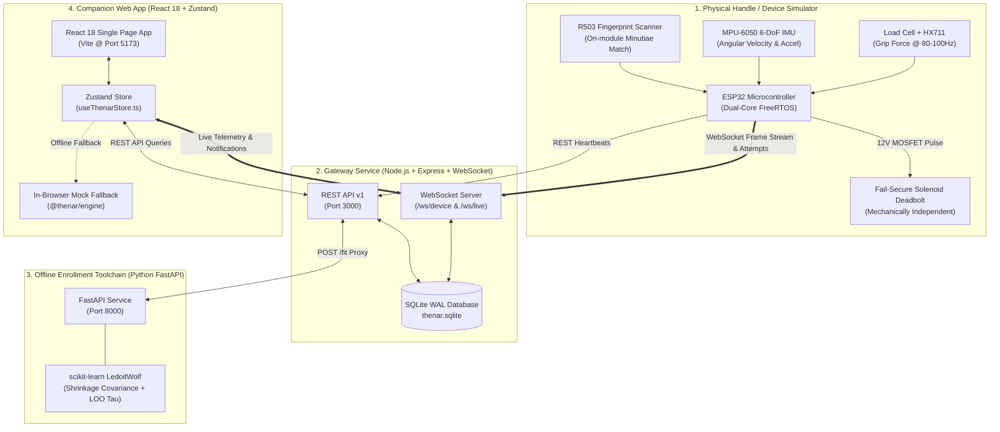

# Thenar System Architecture

## 1. Executive Summary & Design Principles

Thenar is a smart-safe handle telemetry and dual-gate behavioral biometrics system.

### Core Architecture Rules:
1. **Decision Authority**: The unlock decision is made **ON THE DEVICE (ESP32)**. The Gateway NEVER decides to unlock.
2. **Fail-Secure Independence**: The handle is mechanically independent of the solenoid deadbolt. On power failure, software crash, or sensor disconnection, the bolt remains mechanically extended.
3. **Zero Raw Fingerprint Transmission**: Only the scalar outcome (`accept`/`reject` + template ID) is transmitted. Raw minutiae and templates never leave the biometric module.
4. **Experiment vs Normal Mode**: Normal mode stores scalar attempt metrics and per-feature deviations for rejects only. Raw 100 Hz kinematic frames are stored in SQLite **only** when `experimentMode: true`.
5. **Resilient Degradation**: If the Gateway is unreachable, the Companion Web App smoothly activates the in-browser fallback engine with an "Offline Demo Mode" indicator, ensuring presentations are never interrupted.
